# 시큐어 코딩 적용 보고서

- 이름: 이우진
- 제출일: 2026-11-05
- 수정한 취약점: 과제 영역 **8개** + 추가로 발견한 **13개 중 12개** (9번 세션 고정은 수정 금지 파일이라 기록만) → 발견 21개, 수정 20개
- 자가 점검 테스트 결과: `21 / 21` 통과
- 자동 점검 스크립트(`verify/check.ps1`) 결과: `44 / 44` 통과
- SpotBugs 결과: 실제 취약점(우선순위 1) 5건 → `0건`, 전체 경고 23건 → 18건 (추가10~13 적용 전 검사)
- 기능 확인(DB 초기화 후): 로그인 · 대출 조회 · 상환 · 회원가입 · 고객 조회 정상

## 진행 요약

| 순서 | 수정한 영역 | 자가 점검 테스트(21개) 실패 수 |
|---|---|---|
| 0 | 수정 전 | 20 |
| 1 | [1] SQL 삽입 | 18 |
| 2 | [2] IDOR + [7] 상환 | 15 |
| 3 | [7] 이자 계산 | 13 |
| 4 | [4] 에러 처리 | 11 |
| 5 | [3] 민감정보 | 8 |
| 6 | [5] 입력값 검증 | 6 |
| 7 | [6] 해시·암호화·키 | 2 |
| 8 | [8] XSS·CSRF | **0 (BUILD SUCCESS)** |
| 9 | 추가로 발견한 문제 12건 (13건 중 9번 제외) | 0 (유지), 점검 스크립트 44/44 |

**진행 방식**

- 실행 환경은 Oracle 21c XE(`C##SECURE`), Java 17입니다.
- 비밀번호와 키는 환경 변수(`ASSIGN_DB_PASSWORD`, `ASSIGN_AES_KEY`)로만 넣었습니다.
  - 보고서와 소스에는 실제 값을 적지 않았습니다.
- 영역마다 **먼저 공격을 재현**하고, 고친 뒤 같은 요청으로 다시 확인했습니다.
- 중간에 재현하지 못한 `rate=abc`, 음수 상환, 동시 상환은 원본 앱으로 재현했습니다.
  - 원본 zip을 별도 폴더에 풀어 실행했고, 수정한 프로젝트에는 영향을 주지 않았습니다.
- 바뀐 데이터는 `01_schema.sql`로 초기화한 뒤 기존 기능을 다시 확인했습니다.
- 재현·확인 화면은 `docs/screenshots/`에 넣었습니다. (개인 탭·즐겨찾기는 잘라냈습니다)
- 모든 확인을 한 번에 다시 돌리는 점검 스크립트 `verify/check.ps1`을 만들었습니다. (아래 "자동 점검 스크립트")
- 새로 만든 파일은 4가지입니다. 나머지는 기존 파일을 고쳤습니다.
  - `domain/CustomerView.java`: 고객 조회 응답 전용 객체 ([3])
  - `web/SecurityHeaderFilter.java`: 모든 응답에 보안 헤더를 붙이는 필터 (추가 10·13)
  - `verify/check.ps1`: 자동 점검 스크립트 (44개 검사)
  - `docs/screenshots/`: 재현·확인 캡처 19장
- 보고서의 모든 재현·확인 결과(응답, 상태 코드, DB 값, 테스트 결과, SpotBugs 결과)는 직접 로컬에서 실행해서 얻은 값입니다.
  - 추정하거나 지어낸 값은 없습니다.
- 취약점 분석과 수정 방법, 보고서 정리에는 AI(Claude)의 도움을 받았습니다.
  - 코드는 한 줄씩 직접 고치고 실행해서 확인했습니다.

---

## 표준 분류 (CWE / OWASP Top 10 / 행안부 보안약점)

고친 항목을 업계 표준 번호와 이어 두었습니다. 금융권 보안 점검에서 쓰는 기준과 같은 말로 설명하기 위해서입니다.

| 영역 | CWE | OWASP Top 10 (2021) | 행안부 SW 보안약점 (진단가이드) |
|---|---|---|---|
| [1] SQL 삽입 | CWE-89 | A03 Injection | 입력데이터 검증 및 표현 — SQL 삽입 |
| [2] IDOR | CWE-639 | A01 Broken Access Control | 보안기능 — 부적절한 인가 |
| [3] 민감정보 노출 (응답) | CWE-359 | A01 Broken Access Control | — (개인정보 마스킹 기준) |
| [3] 민감정보 노출 (로그) | CWE-532 | A09 Logging and Monitoring Failures | — |
| [4] 에러 처리 | CWE-209 | A04 Insecure Design | 에러처리 — 오류 메시지 정보노출 |
| [5] 입력값 검증 | CWE-20 | A03 Injection | 입력데이터 검증 및 표현 (분류 전체) |
| [5] 4자 비밀번호 허용 | CWE-521 | A07 Identification and Authentication Failures | 보안기능 — 취약한 비밀번호 허용 |
| [6] ECB 모드 | CWE-327 | A02 Cryptographic Failures | 보안기능 — 취약한 암호화 알고리즘 사용 |
| [6] 솔트 없는 MD5 | CWE-759 | A02 Cryptographic Failures | 보안기능 — 솔트 없이 일방향 해쉬 함수 사용 |
| [6] 고정 키, DB 비밀번호 평문 | CWE-321, CWE-798 | A02 / A07 | 보안기능 — 하드코드된 중요정보 |
| [7] 동시 상환 | CWE-367 | A04 Insecure Design | 시간 및 상태 — 경쟁조건: 검사시점과 사용시점 |
| [7] 이자 1원 절사 | CWE-681 | A04 Insecure Design | — |
| [8] XSS | CWE-79 | A03 Injection | 입력데이터 검증 및 표현 — 크로스사이트 스크립트 |
| [8] CSRF | CWE-352 | A01 Broken Access Control | 입력데이터 검증 및 표현 — 크로스사이트 요청 위조 |
| 추가1 상환 API CSRF | CWE-352 | A01 Broken Access Control | 입력데이터 검증 및 표현 — 크로스사이트 요청 위조 |
| 추가5 클릭재킹 | CWE-1021 | A04 Insecure Design | — |
| 추가6 SameSite 없음 | CWE-1275 | A01 Broken Access Control | — |
| 추가7 해지 대출 상환 | CWE-840 | A04 Insecure Design | — |
| 추가10 보안 헤더 누락 | CWE-693 | A05 Security Misconfiguration | — |

- 행안부 항목은 「소프트웨어 보안약점 진단가이드」(행정안전부·KISA)의 항목 이름입니다.
- "—"는 진단가이드에 꼭 맞는 항목이 없는 경우입니다. 억지로 끼워 넣지 않았습니다.
- `[7]` 두 줄과 추가7은 코드 한 줄의 실수보다 업무 규칙 설계의 문제라서, A04(설계 단계 문제)로 분류했습니다.
- `[7]` 두 줄(CWE-367, CWE-681)과 추가10(CWE-693)은 OWASP 공식 매핑표에 없는 CWE라서, 내용에 가장 가까운 항목으로 판단해 넣었습니다.

---

## 항목별 수정 내역

### [1] SQL 삽입

**취약 원인**

- `findByCustomer`가 `'${customerId}'`로 입력값을 SQL 문자열에 그대로 붙였습니다.
  - `${}`는 바인딩이 아니라 치환이라, `'`가 들어가면 SQL 구조가 바뀝니다.
- `ORDER BY ${sortBy}`는 컬럼명 자리라 `#{}`를 못 쓰는데, 값을 검사하지 않았습니다.

**공격 재현 (수정 전)**

| 요청 | 결과 |
|---|---|
| `/api/loans?customerId=' OR '1'='1` | 타인 대출까지 **4건 전부 노출** |
| `/api/loans/sorted?...&sortBy=nosuch` | `ORA-00904: "NOSUCH"` |

- 첫 번째 요청은 `WHERE customer_id = '' OR '1'='1'`이 되어 항상 참이었습니다.

**수정 내용**

| 파일 | 변경 전 | 변경 후 |
|---|---|---|
| `LoanMapper.xml` | `'${customerId}'` | `#{customerId}` |
| `LoanService.java` | 검증 없음 | 허용 목록 검사 |

```java
private static final Set<String> ALLOWED_SORT = Set.of("loan_id", "balance");

if (!ALLOWED_SORT.contains(sortBy)) {
    throw new IllegalArgumentException("허용되지 않은 정렬 기준입니다.");
}
```

- 위험 문자를 골라 막는 블랙리스트는 빠뜨리기 쉬워서, 허용할 값만 정했습니다.

**확인 (수정 후)**

| 요청 | 결과 |
|---|---|
| `sortBy=nosuch` | 400 `잘못된 요청입니다.` |
| `sortBy=balance` | 1004 → 1001 순으로 정렬 |
| 자가 점검 `[1]` 2개 | 통과 |

---

### [2] 접근 통제 (IDOR)

**취약 원인**

- 단건 조회와 상환 SQL이 `loan_id`만 조건으로 써서, 대출의 주인을 확인하지 않았습니다.
- 컨트롤러가 로그인 여부만 보고, `requireCustomer()`가 돌려준 로그인 ID는 버렸습니다.

**공격 재현 (수정 전)** — C001로 로그인한 상태

| 요청 | 결과 |
|---|---|
| `GET /api/loans/1002` (C002 소유) | 타인 대출 조회됨 |
| 1002번 1,000원 상환 | `상환 처리: true` |
| `/api/loans?customerId=C002` | 타인 대출 목록 조회됨 |

- 1002번 상환 후 DB 잔액이 30,000,000 → **29,999,000**으로 실제로 줄었습니다.
- 세 번째는 자가 점검 테스트가 검사하지 않는 곳입니다. ("추가로 발견한 문제" 4)

**수정 내용**

| 파일 | 변경 내용 |
|---|---|
| `LoanMapper.xml` | `findById`에 소유자 조건 추가 |
| `LoanMapper.java` | `findById`에 `customerId` 추가 |
| `LoanController.java` | 로그인 ID로 조회, 없으면 404 |
| `LoanController.java` | 목록·정렬도 본인 아니면 404 |

```java
String me = LoginController.requireCustomer(session);
Loan loan = loanMapper.findById(loanId, me);
if (loan == null) {
    throw new ResponseStatusException(HttpStatus.NOT_FOUND);
}
```

- 상환은 [7]의 조건부 UPDATE에 소유자 조건을 함께 넣었습니다.

**확인 (수정 후)**

| 요청 | 결과 |
|---|---|
| `GET /api/loans/1002` (타인) | 404 |
| `GET /api/loans/9999` (없는 번호) | 404 |
| `GET /api/loans/1001` (본인) | 정상 조회 |
| 1002 상환 / 1001 상환 | `false` / `true` |
| `/api/loans?customerId=C002` | 404 |

- 타인과 없는 번호 모두 `{"message":"요청을 처리할 수 없습니다."}`로 똑같습니다.

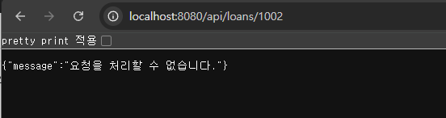

*수정 후: C001로 로그인한 상태에서 /api/loans/1002 → 404, 공통 메시지만 응답*

**타인 자원 접근 시 응답 코드를 무엇으로 정했고, 그 이유는?**

- **404**로 정했습니다.
- 403이면 "대출은 있지만 당신 것이 아니다"가 드러나서, 번호를 바꿔 가며 존재하는 대출을 알아낼 수 있습니다.
- 타인 것과 없는 것을 똑같이 404로 응답하면 존재 여부를 추측할 수 없습니다.

---

### [3] 민감정보 노출

**취약 원인**

| 구분 | 원인 |
|---|---|
| 응답 | DB 원본 객체 `Customer`를 그대로 반환 |
| 응답 | 본인 확인 없음 |
| 로그 | `toString()`에 주민번호·해시 포함 |
| 로그 | 가입 요청 객체 전체를 기록 |

- `SignupRequest`는 record라서, 자동으로 만든 `toString()`이 비밀번호까지 출력합니다.

**공격 재현 (수정 전)**

| 요청 | 결과 |
|---|---|
| `/api/customers/C001` | 주민번호·전화번호 평문 |
| `/api/customers/C002` | 타인 정보까지 노출 |
| 서버 로그 (고객 조회) | 주민번호·전화번호 평문 |
| 서버 로그 (가입) | 비밀번호·주민번호 평문 |

- C001 응답에 `"rrn":"900101-1234567"`, 내부 필드명 `"passwordHash"`까지 보였습니다.
- 가입 로그(테스트용 가짜 데이터): `SignupRequest[..., rrn=950101-1234567, ..., password=Passw0rd!23]`
- DB에는 해시와 암호화를 해서 넣는데, 로그에는 원본이 평문으로 남았습니다.

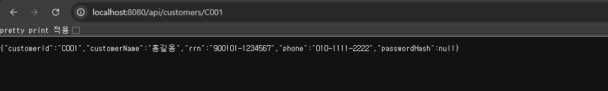

*수정 전: 주민번호·전화번호 평문, passwordHash 필드까지 노출*

**수정 내용**

| 파일 | 변경 내용 |
|---|---|
| `CustomerView.java` (신규) | 응답 전용 DTO |
| `CustomerController.java` | 본인만 조회, 마스킹, 로그는 ID만 |
| `Customer.java` | `toString()`에 ID·이름만 |
| `AuthController.java` | 로그는 `customerId`만 |

- `CustomerView`에는 `customerId`, `customerName`, `rrnMasked`, `phoneMasked`만 담았습니다.
- 마스킹은 제공된 `MaskingUtil`을 썼습니다.

**확인 (수정 후)**

| 요청 | 결과 |
|---|---|
| `/api/customers/C001` | 마스킹된 값만 응답 |
| `/api/customers/C002` | 404 |
| 서버 로그 | `customerId=C001`만 기록 |
| 자가 점검 `[3]` 3개 | 통과 |

- C001 응답: `"rrnMasked":"900101-1******"`, `"phoneMasked":"010-****-2222"`

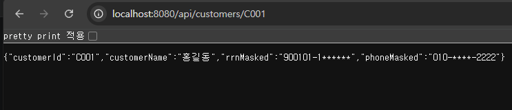

*수정 후: 마스킹된 값만 응답*

---

### [4] 에러 처리

**취약 원인**

- 모든 예외를 `e.toString()`으로 응답해서 예외 클래스명, 메시지, SQL, 서버 경로가 보였습니다.
  - 이 정보로 공격자가 DB 종류와 테이블 구조를 알고, 다음 공격을 정확하게 준비할 수 있습니다.
- 모든 예외를 500으로 바꿔서 401, 404 같은 상태 코드까지 500이 됐습니다.

**공격 재현 (수정 전)**

| 요청 | 결과 |
|---|---|
| `rate=abc` (원본 앱) | `NumberFormatException` 노출 |
| `sortBy=nosuch` | `ORA-00904`, SQL 전문, 경로 노출 |
| `/api/loans/1002` ([2] 직후) | 404가 500으로 응답됨 |

- `rate=abc` 응답 원문: `java.lang.NumberFormatException: For input string: "abc"`

**수정 내용** — 예외 종류별로 나눴습니다.

| 예외 | 상태 | 메시지 |
|---|---|---|
| `ResponseStatusException` | 원래 그대로 | 요청을 처리할 수 없습니다. |
| `IllegalArgumentException` | 400 | 잘못된 요청입니다. |
| `MethodArgumentNotValidException` | 400 | 입력값을 확인해 주세요. |
| 요청 형식 오류 3종 (아래) | 400 | 잘못된 요청입니다. |
| `NoResourceFoundException` | 404 | 요청을 처리할 수 없습니다. |
| `HttpRequestMethodNotSupportedException` | 405 | 요청을 처리할 수 없습니다. |
| `DuplicateKeyException` | 409 | 이미 사용 중인 값입니다. |
| `HttpMediaTypeNotSupportedException` | 415 | 요청을 처리할 수 없습니다. |
| 그 밖의 예외 | 500 | 요청을 처리할 수 없습니다. + `errorId` |

- 요청 형식 오류 3종
  - `MethodArgumentTypeMismatchException`: 숫자 자리에 글자가 옴
  - `MissingServletRequestParameterException`: 필요한 값이 빠짐
  - `HttpMessageNotReadableException`: JSON이 깨짐
  - 이 세 개와 404·405·409·415 처리기는 테스트 통과 후 추가로 점검하다가 넣었습니다. ("추가로 발견한 문제" 2, 3)

```java
String errorId = UUID.randomUUID().toString();
log.error("처리 중 오류 errorId={}", errorId, e);   // 상세는 서버 로그에만
```

- 500 오류일 때 사용자는 일반 메시지와 `errorId`만 받고, 운영자는 그 번호로 서버 로그에서 원인을 찾습니다.
- 400·404·405·409·415는 사용자 요청이 잘못된 경우라 서버 로그에서 찾을 원인이 없어서, `errorId` 없이 공통 메시지만 응답합니다.
  - 안내의 재현 `rate=abc`도 숫자가 아닌 금리(사용자 입력 문제)라서 400 + 공통 메시지로 응답합니다.

**확인 (수정 후)**

| 요청 | 결과 |
|---|---|
| `rate=abc` | 400 `잘못된 요청입니다.` |
| `/api/loans/1002` | 404 `요청을 처리할 수 없습니다.` |
| `principal=abc`, 값 빠짐, 깨진 JSON | 400 |
| `/nothing` (없는 주소) | 404 |
| `GET /login` (메서드가 틀림) | 405 |
| 가입을 `text/plain`으로 보냄 | 415 |
| 이미 있는 ID로 가입 | 409 |
| 자가 점검 `[4]` 2개 | 통과 |

- 테스트 로그에서 `errorId=b6f0a1be-...` 아래에 `ORA-00942` 상세가 찍혔습니다.
  - 상세 내용은 서버 로그에만 있고, 응답 본문에는 없었습니다.

---

### [5] 입력값 검증

**취약 원인**

- `SignupRequest`에 검증 규칙이 없고 `signup`에 `@Valid`도 없어서, 어떤 값이든 저장됐습니다.
  - `<script>`가 든 이름이 저장되면, 나중에 그 이름을 출력하는 화면에서 스크립트가 실행될 수 있습니다(저장형 XSS).
  - 형식이 틀린 주민번호·전화번호와 4자 비밀번호도 그대로 저장되어 데이터와 계정 보안이 함께 약해집니다.

**공격 재현 (수정 전)** — `POST /api/signup`

| 요청 본문 | 결과 |
|---|---|
| 잘못된 값 5개 (ID `C1' OR '1'='1`) | 500 (DB 길이 초과) |
| 같은 값, ID만 `C1'--` | **가입 성공** |

- 잘못된 값 5개: ID `C1' OR '1'='1`, 이름 `<script>alert(1)</script>`,
  주민번호 `not-a-rrn`, 전화 `123`, 비밀번호 `1234`
- 첫 번째 500은 검증이 아니라 DB 컬럼 길이(10자) 초과였고, ID를 줄이자 전부 저장됐습니다.

**수정 내용 — 필드별 규칙과 이유**

| 필드 | 규칙 |
|---|---|
| 고객 ID | `@NotBlank` `@Pattern("^[A-Za-z0-9]{1,10}$")` |
| 이름 | `@NotBlank` `@Pattern("^[가-힣A-Za-z ]{1,50}$")` |
| 주민번호 | `@NotBlank` `@Pattern("^\\d{6}-\\d{7}$")` |
| 전화번호 | `@NotBlank` `@Pattern("^01\\d-\\d{3,4}-\\d{4}$")` |
| 비밀번호 | `@NotBlank` `@Size(min = 8, max = 64)` |

| 필드 | 이렇게 정한 이유 |
|---|---|
| 고객 ID | 영문·숫자만 → `'`, `-` 같은 SQL 특수문자 차단 |
| | 최대 10자 → DB 컬럼 길이와 맞춤 |
| 이름 | 한글·영문·공백만 → `<`, `>` 태그 문자 차단 |
| | 최대 50자 → DB 컬럼 길이와 맞춤 |
| 주민번호 | 숫자6-숫자7 형식만 허용 |
| 전화번호 | 휴대폰 번호 형식만 허용 |
| 비밀번호 | 8자 이상 → 너무 짧은 비밀번호 차단 |
| | 64자 이하 → 긴 입력으로 해시에 부담 주는 것 차단 |

- `@NotBlank`는 null, 빈 문자열, 공백만 있는 값을 모두 막습니다.
- `signup` 파라미터에 `@Valid`를 붙이고, `GlobalExceptionHandler`에 검증 실패 처리기(400)를 추가했습니다.
  - 처음에는 이 처리기가 없어서 검증 실패가 500으로 나왔습니다.

**확인 (수정 후)**

| 요청 | 결과 |
|---|---|
| 정상 요청 (C200) | 가입 성공 |
| 잘못된 요청 (ID `C2'--`) | 400, 가입 안 됨 |
| 자가 점검 `[5]` 3개 | 통과 |

- 정상 요청 값: `Park`, `950101-1234567`, `010-1234-5678`, `Passw0rd!23`

---

### [6] 비밀번호 해시 / 암호화 / 키 관리

**취약 원인**

| 대상 | 원인 |
|---|---|
| 비밀번호 | 솔트 없는 MD5 |
| 주민번호 | `AES/ECB` + 코드에 박힌 고정 키 |
| 키 | 주입받은 키를 쓰지 않음 |
| 설정 파일 | DB 비밀번호가 평문으로 들어 있음 |

- MD5는 같은 비밀번호가 어디서나 같은 해시가 되고, 매우 빨라서 무차별 대입에 약합니다.
- ECB는 같은 평문이 항상 같은 암호문이 되고, 위·변조도 감지하지 못합니다.
- 설정 파일에 비밀번호가 있으면 환경 변수 없이도 실행되고, 소스만 봐도 알 수 있습니다.

**공격 재현 (수정 전)**

테스트용 계정 C100으로 가입한 뒤 DB 값을 확인했습니다.

| 컬럼 | 값 |
|---|---|
| `rrn` | `c7XGU9T1sxr55xxB7nwhmg==` |
| `password_hash` | `c38a2596041205d84655100bfc74dbf8` |

- 두 값이 자가 점검 테스트의 실패 메시지와 **완전히 같았습니다.**
  - 앱은 환경 변수로, 테스트는 무작위로 키를 넣는데 결과가 같습니다.
  - 주입한 키를 무시하고 고정 키를 쓴다는 증거입니다.
- 해시는 32자리 MD5 형식이고 솔트가 없습니다.

**수정 내용**

| 파일 | 변경 전 | 변경 후 |
|---|---|---|
| `application.properties` | 평문 비밀번호 | `${ASSIGN_DB_PASSWORD}` |
| `application.properties` | 빈 AES 키 | `${ASSIGN_AES_KEY}` |
| `AesCrypto.java` | `AES/ECB` + 고정 키 | `AES/GCM` + 주입 키 |
| `PasswordHasher.java` | MD5 | PBKDF2-SHA256 + 솔트 |

- 설정 파일에는 기본값(`${X:값}`)을 두지 않았습니다.
  - 기본값이 있으면 환경 변수를 빠뜨려도 조용히 실행되기 때문입니다.
- `AesCrypto`는 암호화할 때마다 무작위 12바이트 IV를 만들고, 키가 없으면 예외를 던집니다.
  - IV는 비밀이 아니라서 암호문 앞에 붙여 함께 저장합니다.
- `PasswordHasher`는 무작위 16바이트 솔트와 60만 회 반복을 씁니다.
  - 저장 형식은 `salt:hash`이고, 비교는 상수 시간(`MessageDigest.isEqual`)으로 합니다.

**확인 (수정 후)**

| 확인 | 결과 |
|---|---|
| 환경 변수 없이 실행 | 시작 거부 |
| 같은 값으로 C200 가입 | C100과 완전히 다르게 저장 |
| 자가 점검 `[6]` 4개 | 통과 |

- 시작 거부 메시지: `Could not resolve placeholder 'ASSIGN_AES_KEY'`

| | 주민번호 | 비밀번호 |
|---|---|---|
| C100 (수정 전) | `c7XGU9T1sxr5...` | `c38a2596...` (MD5) |
| C200 (수정 후) | `21zTqYOKev6v...` (IV 포함) | `37b3b1c6...:457e...` (솔트:해시) |

---

### [7] 금액 계산 / 동시성

**취약 원인**

| 대상 | 원인 |
|---|---|
| 이자 계산 | `double` 후 `(long)` → 반올림 없이 버림 |
| 이자 계산 | 원금·금리 범위 검사 없음 |
| 상환 금액 | 0·음수 통과 → 잔액이 늘어남 |
| 동시성 | 조회 → 비교 → 덮어쓰기가 나뉘어 있음 |

- 동시 요청이 같은 잔액을 읽고 각자 덮어써서, 서로의 차감이 사라집니다(Lost Update).

**공격 재현 (수정 전)**

| 요청 | 결과 |
|---|---|
| `rate=0.035` | `2916` (정답 2917) |
| `rate=-1` | `-83333` |
| 음수 상환 `amount=-1000000` (원본 앱) | `success: true` |
| 1004에 100만 원 **50건 동시** (원본 앱) | 성공 50건 |

- 음수 상환 후 1001 잔액이 12,500,000 → **13,500,000**이 됐습니다. 상환했는데 빚이 늘었습니다.
- 동시 상환 후 1004 잔액은 8,000,000에서 **5,000,000**이 됐습니다.
  - **초과 상환:** 잔액상 최대 8건만 성공해야 하는데 50건 모두 성공했습니다.
  - **Lost Update:** 50건이면 5,000만 원이 빠져야 하는데 300만 원만 줄었습니다.


*수정 전: rate=0.035 → 2916 (`(long)` 변환으로 소수점 아래를 버림)*

**수정 내용**

| 파일 | 변경 내용 |
|---|---|
| `LoanMapper.xml` | 조회·갱신 2개 → 조건부 UPDATE 1개 |
| `LoanMapper.java` | `repayConditional()` 추가 |
| `LoanService.repay` | 0 이하 거부, 1행 바뀌면 성공 |
| `LoanService.monthlyInterest` | `BigDecimal` + `HALF_UP` + 범위 검사 |

```xml
UPDATE loan
   SET balance = balance - #{amount}
 WHERE loan_id = #{loanId}
   AND customer_id = #{customerId}
   AND balance >= #{amount}
   AND status = 'ACTIVE'      -- "추가로 발견한 문제" 7에서 추가
```

- 소유자·잔액 확인과 차감을 DB가 한 문장으로 처리해서, 다른 요청이 끼어들 수 없습니다.
- 이자는 `new BigDecimal(문자열)`로 오차 없이 계산하고, 원금 0 이하·금리 0~1 밖은 거부합니다.
  - `abc`는 `new BigDecimal`이 예외를 던져 400이 됩니다.

**확인 (수정 후)**

| 요청 | 결과 |
|---|---|
| `rate=0.035` / `rate=-1` | `2917` / 400 |
| 음수 상환 | 400 `잘못된 요청입니다.` |
| 1004에 100만 원 10건 동시 | 성공 **8건**, 실패 2건 |
| 자가 점검 `[7]` 4개 | 통과 |

- 동시 상환은 `curl.exe --parallel`로 보냈고, 출력 줄이 섞여 나와 실제로 동시에 처리됐습니다.
- 동시 상환 후 1004 잔액은 정확히 **0**이었습니다.

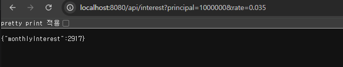

*수정 후: rate=0.035 → 2917 (BigDecimal + HALF_UP)*

| | 원본 (50건) | 수정 후 (10건) |
|---|---|---|
| 성공 응답 | 50건 | 8건 |
| 최종 잔액 | 5,000,000 | 0 |
| 판정 | 4,700만 원 누락 | 성공 건수와 일치 |

---

### [8] XSS / CSRF

**취약 원인**

| 대상 | 원인 |
|---|---|
| XSS (`search.jsp`) | 입력값을 HTML로 해석해서 출력 |
| CSRF (`/repay-form`) | 로그인 쿠키만 확인 |

- XSS는 `${q}`, `<%= request.getParameter("q") %>`, `innerHTML` 세 곳에 있었습니다.
- CSRF는 다른 사이트에서 폼을 보내도 본인 요청으로 처리됐습니다.

**공격 재현 (수정 전)**

| 요청 | 결과 |
|---|---|
| `/search?q=` | 알림 창 실행 |
| 로그인 직후 `csrf-attack.html` 열기 | `상환 처리: true` |

- XSS는 세 곳 모두 글자 대신 태그로 렌더링됐습니다.
  - 알림 창 대신 다른 스크립트를 넣으면, 링크를 누른 사용자의 브라우저에서 화면을 바꾸거나 요청을 몰래 보낼 수 있습니다.
- CSRF는 사용자가 누르지 않았는데 1001번 대출에서 100만 원이 상환됐습니다.

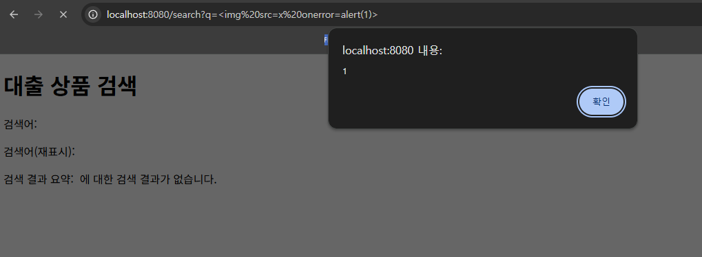

*수정 전: 검색어의 태그가 실행되어 알림 창이 뜸*

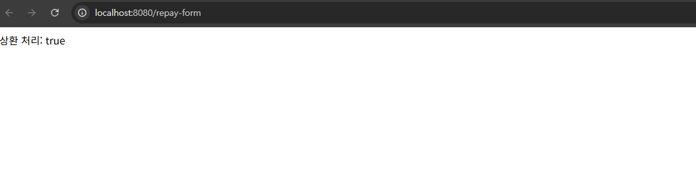

*수정 전: csrf-attack.html을 열자마자 상환 처리: true*

**수정 내용**

| 파일 | 변경 전 | 변경 후 |
|---|---|---|
| `search.jsp` | `${q}` | `<c:out value="${q}" />` |
| `search.jsp` | `<%= ... %>` | `<c:out value="${param.q}" />` |
| `search.jsp` | `innerHTML` | `textContent` |
| `PageController.java` | 토큰 없음 | 토큰 발급·검증, 다르면 403 |
| `repay-form.jsp` | 토큰 없음 | 숨은 칸 `_csrf` |

- 폼을 열 때 무작위 토큰을 만들어 세션과 폼에 넣고, 상환할 때 비교해서 다르면 403을 던집니다.
- 공격 페이지는 우리 서버의 폼을 읽을 수 없어서 토큰 값을 모릅니다.

**확인 (수정 후)**

| 요청 | 결과 |
|---|---|
| `/search?q=` | 글자로 표시 |
| `/search?q=<script>alert(1)</script>` (안내의 재현 값) | 세 곳 모두 글자로 표시, 알림 창 없음 |
| `/repay-form`에서 직접 상환 | `상환 처리: true` |
| `csrf-attack.html` 실행 | **403** |
| `login.jsp` 점검 | 사용자 입력을 출력하는 곳 없음 → XSS 없음 |
| 자가 점검 `[8]` 2개 | 통과 |

- 403은 개발자 도구 Network 탭에서 확인했습니다.
- `login.jsp`는 `${pageContext.request.contextPath}`(서버 설정값)와 고정 문자열만 출력해서, 수정할 곳이 없었습니다.

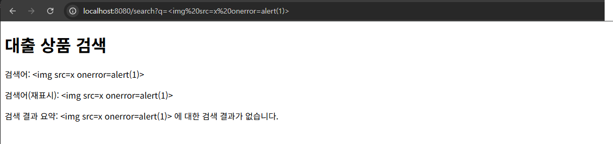

*수정 후: 같은 검색어가 글자로만 표시됨*

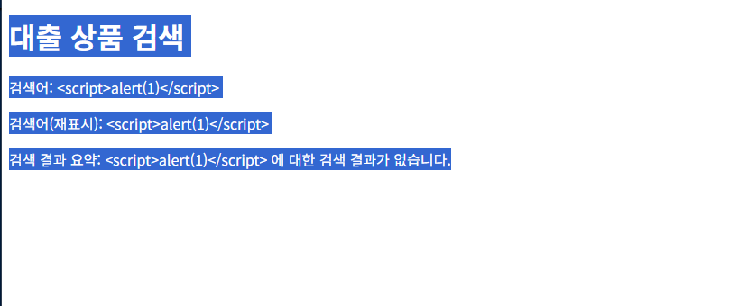alert(1)</script>도 세 곳 모두 글자로만 표시됨">

*수정 후: 안내의 재현 값 `<script>alert(1)</script>`도 세 곳 모두 글자로만 표시됨*

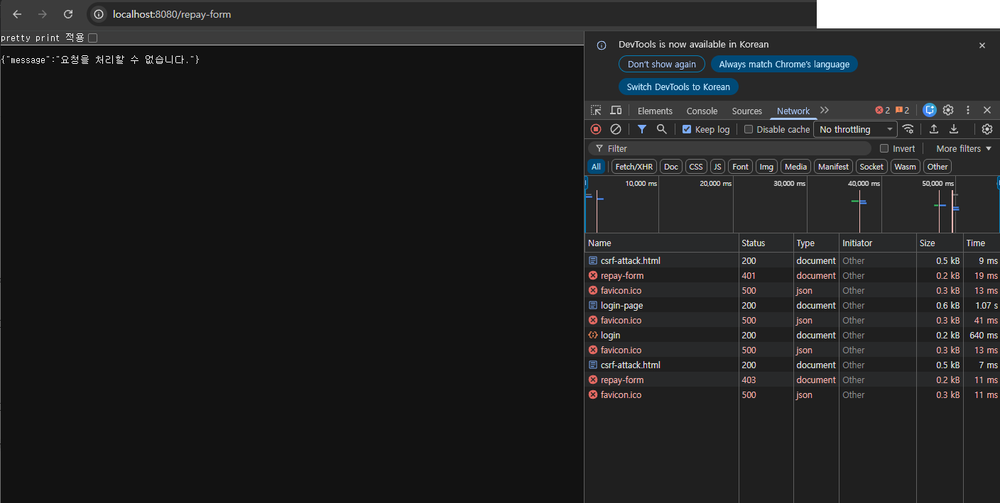

*수정 후: Network 탭 — 2분 경과 시 401, 재로그인 직후 공격 시 403*

- 같은 상환을 하는 API(`POST /api/loans/{id}/repay`)에도 CSRF 방어를 추가했습니다. ("추가로 발견한 문제" 1)
- 클릭재킹 방지 헤더와 쿠키 SameSite 설정도 추가했습니다. ("추가로 발견한 문제" 5, 6)

**참고: 브라우저 기본 방어만으로는 부족함**

- 로그인하고 2분 뒤에 공격하면 403이 아니라 401이 나왔습니다.
  - Chrome은 SameSite가 정해지지 않은 쿠키를 Lax로 취급해 다른 사이트의 POST에 붙이지 않습니다.
  - 단, 쿠키가 생긴 지 2분 이내면 예외로 붙여 줍니다.
- Network 기록에 401(2분 경과)과 403(재로그인 직후)이 둘 다 남았습니다.
- 브라우저 동작은 이렇게 조건부라서 서버의 토큰 검증이 필요합니다.
  - 이 2분 예외는 SameSite를 직접 정해서 없앴습니다. ("추가로 발견한 문제" 6)

---

## 최종 기능 확인 (DB 초기화 후)

| 기능 | 요청 | 결과 |
|---|---|---|
| 로그인 | `/login-page` → C001 | 로그인 성공 |
| 대출 목록 | `/api/loans?customerId=C001` | 1001, 1004 |
| 정렬 | `/api/loans/sorted?...&sortBy=balance` | 1004 → 1001 |
| 단건 조회 | `/api/loans/1001` | 1001 정보 |
| 이자 | `/api/interest?...&rate=0.035` | `2917` |
| 상환 (화면) | `/repay-form` → 1001, 1,000원 | `true` |
| 상환 (API) | 헤더 붙여 `POST /api/loans/1001/repay` | `true` |
| 회원가입 | `POST /api/signup` (C300) | 가입 성공 |
| 고객 조회 | `/api/customers/C001` / `/api/customers/C300` | 마스킹된 값 (`900101-1******` / `950101-1******`) |

---

## 자동 점검 스크립트 (`verify/check.ps1`)

- 보고서의 재현·확인 요청을 한 번에 다시 보내서 결과를 판정하는 PowerShell 스크립트입니다.
- 코드를 바꾼 뒤 다시 돌리면, 고친 취약점이 다시 열렸는지 바로 알 수 있어 **보안 회귀 테스트** 역할을 합니다.
- `src/test` 밖에 있어서 `mvnw test`(자가 점검 21개)에는 영향을 주지 않습니다.

| 구분 | 내용 |
|---|---|
| 실행 | 앱을 띄운 뒤 `powershell -ExecutionPolicy Bypass -File .\verify\check.ps1 -ResetDb` |
| 준비 | `ASSIGN_DB_PASSWORD` 환경 변수, `sqlplus` (비밀번호는 스크립트에 없음) |
| `-ResetDb` | 시작 전·끝난 뒤 `01_schema.sql`로 DB 초기화, 고객 3명 / 대출 4건인지 확인 |
| 점검 수 | [1]~[8] 영역 + 추가로 발견한 문제 1~7, 10~13, 총 **44개** (처음 37개 → 11~13번을 고치면서 7개 추가) |
| 결과 | **44 / 44 통과** (시작 전·끝난 뒤 초기화 모두 성공, 고객 3명 / 대출 4건) |

- 동시 상환은 `curl.exe --parallel`로 잔액보다 2건 많게 보내서, 성공 건수와 남은 잔액이 맞는지 봅니다.
- 쿠키 속성(HttpOnly, SameSite=Lax)은 새로 로그인한 응답 헤더에서 확인합니다.
- 해지 대출(추가7)은 `-ResetDb`일 때만 1001의 상태 값을 `CLOSED`로 바꿔 검사하고, 끝난 뒤 초기화로 되돌립니다.
- 스크립트는 DB 스키마를 바꾸지 않고, 과제에서 준 `01_schema.sql`만 다시 실행합니다.
- 11~13번을 고치면서, 보고서에는 고쳤다고 적었는데 스크립트에는 없던 검사 7개를 추가했습니다.

| 추가한 검사 | 관련 항목 |
|---|---|
| 로그인 없이 대출 조회 → 401 | [2] |
| 남의 대출 정렬 조회 → 404 (목록만 있고 정렬은 빠져 있었음) | 추가4 |
| 깨진 JSON 가입 → 400, 예외 이름 노출 없음 | [4] 추가2 |
| 가입 고객 주민번호 복호화 후 마스킹 → `950101-1******` | 추가11 |
| 잔액보다 1원 많은 상환 → 실패 | [7] |
| 같은 토큰으로 다시 상환 → 403 | 추가12 |
| 고객 조회 응답에 `Cache-Control: no-store` | 추가13 |

---

## 도구가 잡지 못한 항목 (선택)

`.\mvnw.cmd -Psast compile spotbugs:spotbugs`로 원본 프로젝트와 수정한 프로젝트를 각각 검사했습니다.

**수정 전 / 후 결과**

| 구분 | 수정 전 | 수정 후 |
|---|---|---|
| 전체 경고 | 23건 | 18건 |
| 실제 취약점 (우선순위 1) | 5건 | **0건** |

**수정으로 사라진 경고**

| 경고 | 위치 | 고친 영역 |
|---|---|---|
| `ECB_MODE` × 2 | `AesCrypto.encrypt / decrypt` | [6] AES/GCM으로 변경 |
| `CIPHER_INTEGRITY` × 2 | `AesCrypto.encrypt / decrypt` | [6] GCM 인증 태그로 위·변조 감지 |
| `WEAK_MESSAGE_DIGEST_MD5` | `PasswordHasher.hash` | [6] PBKDF2로 변경 |
| `URF_UNREAD_FIELD` | `AesCrypto` 생성자 | [6] 주입받은 키를 실제로 사용 |

- 마지막 경고는 "주입받은 키 필드를 아무도 읽지 않는다"는 뜻으로, 고정 키를 쓰던 문제를 도구가 간접적으로 잡은 것입니다.

**수정 후에도 남은 경고 (모두 확인함)**

| 경고 | 건수 | 판단 |
|---|---|---|
| `SPRING_ENDPOINT` | 12 | 정보 표시. "외부에서 호출되는 주소이니 점검하라"는 목록이며, 12개 모두 직접 점검함 |
| `EI_EXPOSE_REP2` | 3 | 오탐. 생성자로 받은 Mapper·암호화 객체를 저장한다는 경고로, Spring의 정상적인 의존성 주입 방식 |
| `CRLF_INJECTION_LOGS` | 3 | 오탐. 로그에 넣는 값이 줄바꿈을 포함할 수 없음 (아래) |

- 로그 경고 3곳에 들어가는 값은 이렇습니다.
  - `AuthController`: `customerId`는 `@Pattern("^[A-Za-z0-9]{1,10}$")`를 통과한 값만 들어옵니다.
  - `CustomerController`: `customerId`가 로그인 ID와 같을 때만 기록되고, 로그인 ID는 DB에 있는 값입니다.
  - `GlobalExceptionHandler`: `errorId`는 서버가 만든 UUID입니다.

**도구가 잡지 못한 항목**

도구가 잡은 것은 [6]의 암호화·해시 문제뿐이었습니다. 나머지는 모두 도구로는 찾지 못했습니다.

| 영역 | 도구가 못 잡은 이유 |
|---|---|
| [1] SQL 삽입 (`${customerId}`, `ORDER BY`) | SQL이 Java가 아니라 MyBatis XML에 있어서 검사 대상이 아님 |
| [2] IDOR | "누구의 대출인지" 같은 업무 규칙은 코드 모양만으로 알 수 없음 |
| [3] 민감정보 노출 | 어떤 필드가 주민번호인지 도구는 모름 |
| [4] 에러 정보 노출 | `e.toString()` 응답을 위험으로 보지 않음 |
| [5] 입력값 검증 없음 | 검증이 "없는 것"은 찾지 못함 |
| [6] 설정 파일의 평문 비밀번호, 코드의 고정 키 | `.properties`는 검사 대상이 아님. 고정 키 문자열은 직접 잡지 못하고 `URF_UNREAD_FIELD`로 간접적으로만 드러남 |
| [7] 금액 계산, 동시성 | `double` 사용, 조회-판단-갱신 분리를 위험으로 보지 않음 |
| [8] XSS, CSRF | JSP와 화면 흐름은 검사 대상이 아님 |
| 추가 1~13 | 위와 같은 이유로 모두 찾지 못함 |

- 정리하면 SpotBugs는 위험한 함수나 알고리즘 사용은 잘 잡지만, 업무 규칙과 설정, 화면 쪽 문제는 잡지 못했습니다.
- 그래서 도구 검사, 자가 점검 테스트, 직접 공격해 보는 점검을 함께 해야 한다는 것을 확인했습니다.
- 자가 점검 테스트도 정해진 위치만 검사해서, 21개를 통과한 뒤에도 같은 약점이 다른 곳에 남아 있었습니다. ("추가로 발견한 문제")

---

## 추가로 발견한 문제 (선택)

| 번호 | 문제 | 관련 영역 | 조치 |
|---|---|---|---|
| 1 | 상환 API에 CSRF 방어 없음 | [8] | 수정 |
| 2 | 사용자 요청 오류가 500으로 응답됨 | [4] | 수정 |
| 3 | 중복 가입이 500으로 응답됨 | [4] | 수정 |
| 4 | 대출 목록·정렬 조회의 IDOR | [2] | 수정 |
| 5 | 상환 화면을 다른 사이트에 넣을 수 있음 (클릭재킹) | [8] | 수정 |
| 6 | 로그인 쿠키에 SameSite 설정 없음 | [8] | 수정 |
| 7 | 해지된 대출도 상환됨 | [7] | 수정 |
| 8 | 세션 ID가 주소에 붙을 수 있음 | — | 예방 설정 |
| 9 | 로그인 시 세션 ID가 바뀌지 않음 | — | 수정 대상 밖 |
| 10 | 보안 헤더가 상환 화면에만 있음 | [8] | 수정 |
| 11 | 가입한 고객의 주민번호가 전부 `*`로 보임 | [3] [6] | 수정 |
| 12 | 상환 폼 CSRF 토큰을 한 번 쓴 뒤에도 재사용 가능 | [8] | 수정 |
| 13 | 개인정보 응답에 캐시 금지 헤더 없음 | [3] | 수정 |

**1. 상환 API에 CSRF 방어 없음**

| 구분 | 내용 |
|---|---|
| 위치 | `POST /api/loans/{loanId}/repay` |
| 원인 | [8]에서 `/repay-form`만 막아서, 같은 상환을 하는 API는 열려 있음 |
| 재현 | C001 로그인 → 다른 페이지(`data:`)에서 API로 폼 전송 → `success: true` |
| 조치 | `X-Requested-With: XMLHttpRequest` 헤더가 없으면 403 |
| 확인 | 같은 공격 → **403** / 헤더를 붙인 정상 요청 → `success: true` |

- API는 화면 폼이 없어서 숨은 칸으로 토큰을 줄 수 없어, 직접 만든 헤더를 요구하는 방식을 썼습니다.
  - 다른 사이트의 폼은 이런 헤더를 붙여 보낼 수 없습니다.
- 재현 때 Network 탭에서 `repay?amount=1000000`이 200으로, 수정 후에는 403으로 찍혔습니다.

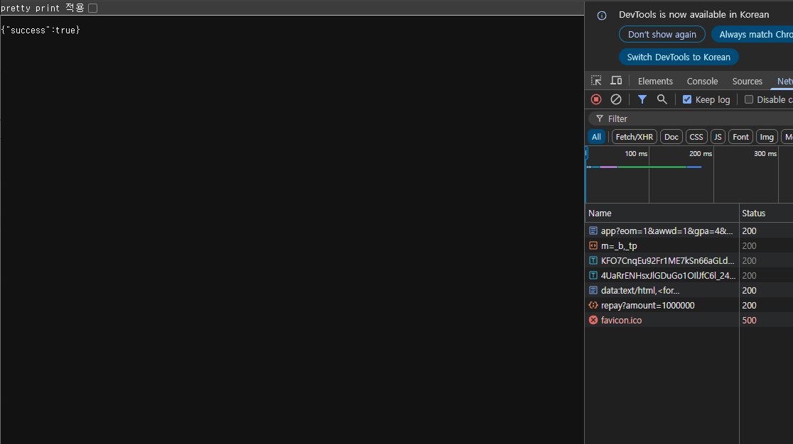

*수정 전: 다른 페이지(data:)에서 보낸 상환 API → success: true*

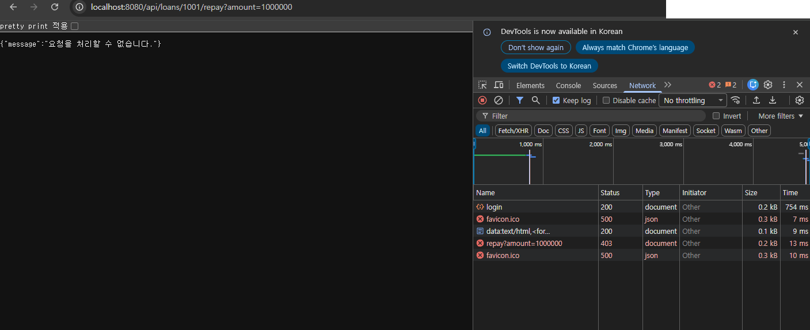

*수정 후: 같은 요청 → 403*

**2. 사용자 요청 오류가 500으로 응답됨**

| 요청 | 수정 전 | 수정 후 |
|---|---|---|
| `/api/interest?principal=abc&rate=0.035` | 500 | 400 |
| `/api/interest?rate=0.035` (값 빠짐) | 500 | 400 |
| 가입 요청 JSON이 깨짐 | 500 | 400 |
| `/nothing`, `/favicon.ico` (없는 주소) | 500 | 404 |
| `GET /login` (POST만 받는 주소) | 500 | 405 |
| 가입을 `text/plain`으로 보냄 | 500 | 415 |

- 원인: [4]의 처리기가 Spring이 던지는 예외 일부를 몰라서 "그 밖의 예외"(500)로 처리됐습니다.
- 내부 정보는 새지 않았지만, 사용자 실수를 서버 고장으로 응답하고 서버 로그에 오류가 쌓였습니다.
- 조치: `GlobalExceptionHandler`에 400·404·405·415 처리기를 추가했습니다. ([4] 표 참고)

**3. 중복 가입이 500으로 응답됨**

| 구분 | 내용 |
|---|---|
| 위치 | `POST /api/signup` |
| 원인 | DB 중복 키 오류(`DuplicateKeyException`)를 처리하는 곳이 없어서 "그 밖의 예외"(500)로 처리됨 |
| 재현 (수정 전) | 이미 있는 ID(C001)로 가입 → **500** |
| 조치 | `GlobalExceptionHandler`에 `DuplicateKeyException` 처리기 추가 → 409 `이미 사용 중인 값입니다.` |
| 확인 (수정 후) | 같은 요청 → **409** ([4] 확인 표, 점검 스크립트 추가3) |

- 사용자가 고를 수 있는 값(ID)이 겹친 것이라 서버 오류가 아니라 충돌(409)로 알려 주는 게 맞습니다.
- 다만 409는 그 ID가 이미 있다는 것을 알려 주는 단점이 있어서, "남은 취약점"의 "ID 존재 여부 노출"에 함께 적었습니다.

**4. 대출 목록·정렬 조회의 IDOR**

| 구분 | 내용 |
|---|---|
| 위치 | `GET /api/loans`, `GET /api/loans/sorted` |
| 원인 | 요청 파라미터 `customerId`를 그대로 믿고 조회 |
| 재현 | C001 로그인 → `?customerId=C002` → 타인 대출 조회됨 |
| 조치 | 로그인 ID와 다르면 404 |
| 확인 | `C002` → 404, `C001` → 본인 대출 2건 |

- 안내문의 [2] 대상(단건 조회, 상환)에는 없던 곳이라, [2]에도 함께 적었습니다.

**5. 상환 화면을 다른 사이트에 넣을 수 있음 (클릭재킹)**

| 구분 | 내용 |
|---|---|
| 위치 | `GET /repay-form` |
| 원인 | 다른 사이트가 `<iframe>`으로 우리 화면을 넣는 것을 막지 않음 |
| 재현 | 9000번 포트에 공격자 페이지를 띄움 → 그 안에 상환 화면이 그대로 보임 |
| 조치 | `X-Frame-Options: DENY`, `Content-Security-Policy: frame-ancestors 'none'` |
| 확인 | 공격자 페이지 안의 칸이 비어 있음 / 직접 열면 정상 |

- 화면 안에 진짜 CSRF 토큰이 들어 있어서, 투명하게 겹쳐 놓고 버튼을 누르게 하면 CSRF 토큰으로는 못 막습니다.
- 재현은 Python(`python -m http.server 9000`)으로 다른 출처의 페이지를 띄워서 했습니다.
  - `data:` 주소로는 Chrome이 `localhost` 접근 자체를 막아서 판단할 수 없었습니다.

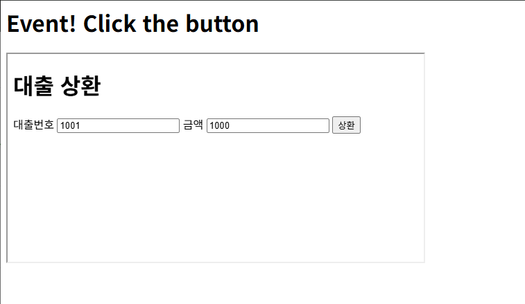

*수정 전: 9000번 포트의 공격자 페이지 안에 상환 화면이 그대로 보임*

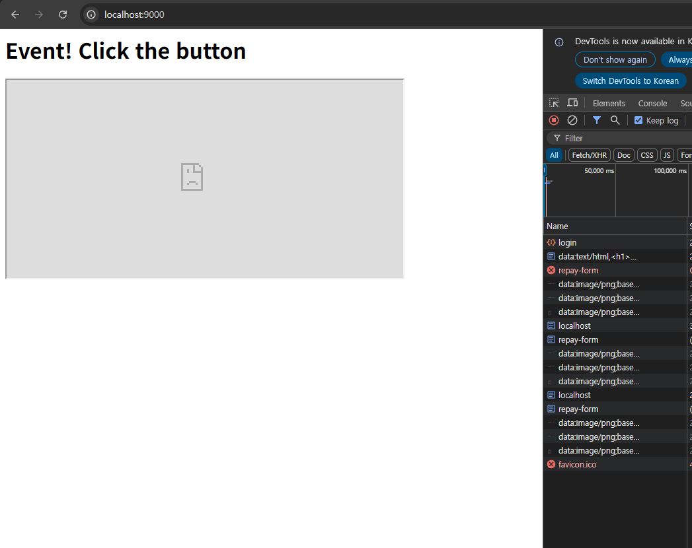

*수정 후: 같은 페이지에서 상환 화면이 차단됨*

**6. 로그인 쿠키에 SameSite 설정 없음**

| 구분 | 내용 |
|---|---|
| 위치 | 로그인 쿠키 `JSESSIONID` |
| 원인 | SameSite를 정하지 않아 Chrome의 "2분 예외"가 적용됨 |
| 재현 | 로그인 직후 `csrf-attack.html` → **403** (쿠키가 붙어서 토큰 단계까지 감) |
| 조치 | `server.servlet.session.cookie.same-site=lax` |
| 확인 | 같은 순서 → **401** (쿠키부터 안 붙음) / 직접 상환 → `true` |
| 쿠키 속성 | 개발자 도구 Cookies 탭: `JSESSIONID`, HttpOnly ✓, SameSite `Lax` |

- 이제 CSRF 방어가 두 겹입니다. 브라우저가 쿠키를 안 붙이고, 붙더라도 서버가 토큰을 검사합니다.
- `strict`가 더 강하지만, 다른 사이트에서 링크로 들어오면 로그인이 풀린 것처럼 보여서 `lax`를 골랐습니다.
- 공격 페이지를 열면 로그인이 풀리는 부작용이 있었습니다.
  - 쿠키 없이 온 요청에 서버가 새 세션 쿠키를 내려줘서, 기존 로그인 쿠키가 바뀌었습니다.
  - 공격은 실패하므로 안전에는 문제없고, 다시 로그인하면 정상으로 상환됩니다.
  - 원인: 컨트롤러가 `HttpSession`을 파라미터로 받으면, 세션이 없을 때 새로 만들어집니다.
  - 해결 방향: 로그인하지 않은 요청에는 `request.getSession(false)`로 세션을 만들지 않게 하면 됩니다.
  - 다만 이 동작은 수정 금지인 `LoginController.requireCustomer()`와 연결되어 있어 이번에는 바꾸지 않았습니다.

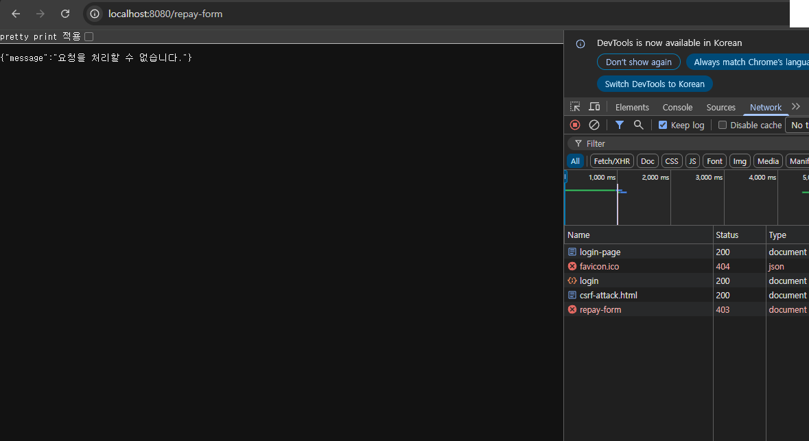

*수정 전: 로그인 직후 공격 → 403 (쿠키가 붙어 토큰 단계까지 감)*

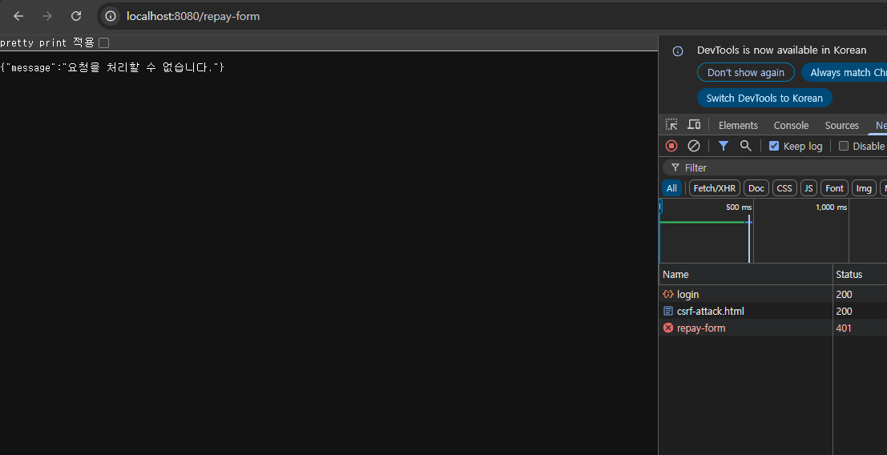

*수정 후: 같은 순서 → 401 (쿠키가 붙지 않음)*

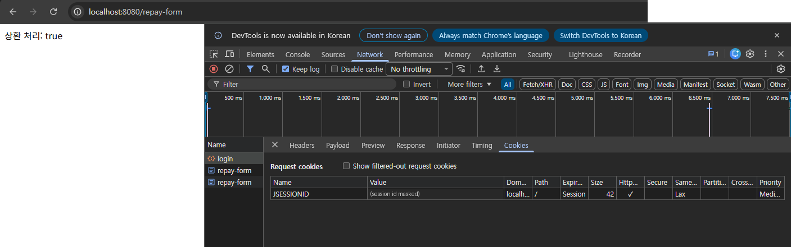

*수정 후: Cookies 탭 — JSESSIONID HttpOnly ✓, SameSite Lax (세션 ID 값은 가림)*

**7. 해지된 대출도 상환됨**

| 구분 | 내용 |
|---|---|
| 위치 | `repayConditional` (상환 UPDATE) |
| 원인 | 대출 상태(`status`)를 확인하지 않음 |
| 재현 | 1004를 `CLOSED`로 바꾼 뒤 상환 → `상환 처리: true` |
| 조치 | WHERE에 `AND status = 'ACTIVE'` 추가 |
| 확인 | 1004(CLOSED) → `false` / 1001(ACTIVE) → `true` |

- 재현은 SQL Developer에서 데이터 값만 바꿔서 했고(스키마는 그대로), 끝난 뒤 `01_schema.sql`로 초기화했습니다.
- `'ACTIVE'`는 사용자 입력이 아닌 고정 값이라 `#{}` 없이 써도 SQL 삽입 위험이 없습니다.

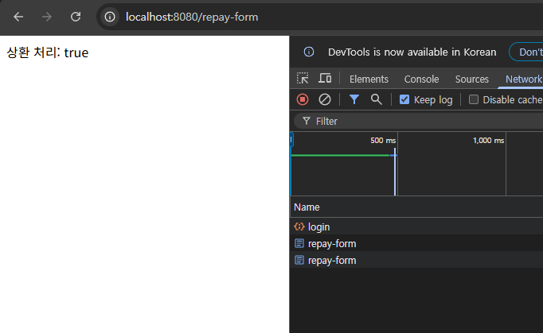

*수정 전: CLOSED로 바꾼 1004 상환 → true*

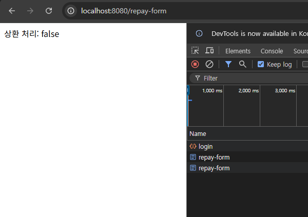

*수정 후: 1004(CLOSED) 상환 → false*

**8. 세션 ID가 주소에 붙을 수 있음 (예방 설정)**

- Tomcat은 쿠키를 끈 브라우저에 `;jsessionid=...`를 주소 뒤에 붙여 세션을 유지할 수 있습니다.
  - 주소는 기록, 공유, Referer 헤더로 쉽게 새어 나가서 세션을 빼앗길 수 있습니다.
- 우리 JSP는 `<c:url>`을 쓰지 않아 실제로 재현되지는 않았습니다.
- 나중에 코드가 바뀌어도 새지 않도록 `server.servlet.session.tracking-modes=cookie`로 쿠키만 쓰게 했습니다.

**9. 로그인 시 세션 ID가 바뀌지 않음 (수정하지 않음)**

- `LoginController`가 로그인할 때 기존 세션을 그대로 써서, 세션 고정(Session Fixation) 공격에 약합니다.
- `LoginController`는 수정 대상이 아니라서 고치지 않았습니다.
  - 실제 서비스라면 로그인 직후 `request.changeSessionId()`로 세션 ID를 새로 발급해야 합니다.

**10. 보안 헤더가 상환 화면에만 있음**

| 구분 | 내용 |
|---|---|
| 위치 | 상환 폼을 뺀 모든 응답 (로그인 화면, 검색 화면, API) |
| 원인 | 5번에서 클릭재킹 방지 헤더를 `PageController.repayForm`에만 넣음 |
| 재현 (수정 전) | 코드 확인: 헤더를 설정하는 곳이 `PageController.repayForm` 한 곳뿐이라, 다른 응답에는 붙지 않음 |
| 조치 | `SecurityHeaderFilter`(신규)로 모든 응답에 보안 헤더를 붙임 (처음 4개, 13번에서 `Cache-Control` 추가해 5개) |
| 확인 | 세 주소 모두 헤더 있음 (점검 스크립트 추가10), 자가 점검 21/21, 점검 스크립트 44/44 |

| 헤더 | 값 | 막는 것 |
|---|---|---|
| `X-Frame-Options` | `DENY` | 다른 사이트의 `<iframe>` (옛 방식) |
| `Content-Security-Policy` | `frame-ancestors 'none'` | 다른 사이트의 `<iframe>` (CSP 방식) |
| `X-Content-Type-Options` | `nosniff` | 브라우저가 파일 형식을 멋대로 추측해 스크립트로 실행하는 것 |
| `Referrer-Policy` | `same-origin` | 다른 사이트로 이동할 때 우리 주소가 새는 것 |
| `Cache-Control` | `no-store` | 응답이 브라우저·프록시 캐시에 남는 것 (13번에서 추가) |

- 화면마다 헤더를 넣으면 새 화면을 만들 때 빠뜨리기 쉬워서, 필터 하나로 모두 적용했습니다.
- CSP에 `script-src`까지 넣으면 `search.jsp`의 인라인 스크립트가 막혀 화면이 깨져서, `frame-ancestors`만 넣었습니다.
- `PageController`의 헤더 설정은 그대로 두었습니다. 같은 값이라 겹쳐도 문제없습니다.
- SpotBugs 결과("도구가 잡지 못한 항목")는 이 필터를 넣기 전에 검사한 것입니다.

**11. 가입한 고객의 주민번호가 전부 `*`로 보임**

| 구분 | 내용 |
|---|---|
| 위치 | `GET /api/customers/{customerId}` |
| 원인 | [6]에서 가입할 때 주민번호를 암호화해 저장하게 했는데, 조회는 복호화 없이 DB 값을 바로 마스킹함. 암호문에는 7번째 자리 `-`가 없어서 `MaskingUtil`이 전부 `*`로 바꿈 |
| 재현 (수정 전) | 코드 확인: [3]은 초기 데이터 C001(평문)로만 확인해서 놓쳤음. 가입 고객은 `******-*******`로 응답하는 구조 |
| 조치 | 평문 형식(`숫자6-숫자7`)이면 그대로, 아니면 `AesCrypto.decrypt()` 후 마스킹. 고객이 없으면 404 |
| 확인 | C001 → `900101-1******` / 새로 가입한 C300 → `950101-1******`, 자가 점검 21/21, 점검 스크립트 44/44 |

- 초기 데이터(C001~C003)는 `01_schema.sql`에 평문으로 들어 있어서, 평문과 암호문을 모두 처리하게 했습니다.
- 같이 `SignupRequest`의 `toString()`도 ID만 나오게 바꿨습니다.
  - 지금은 로그에 찍는 곳이 없지만, record 기본 `toString()`은 비밀번호·주민번호를 그대로 출력해서 나중에 실수로 찍혀도 새지 않게 했습니다.
- 처음에는 C300으로 직접 요청을 보내 확인했고, 이후 점검 스크립트에 「가입 고객 주민번호 복호화 후 마스킹」 검사(추가11)로 넣었습니다.
- 같은 AES 키로 앱을 켜 둔 동안 가입한 고객만 복호화됩니다. 키를 새로 만들어 앱을 다시 켜면 이전 가입 고객은 복호화에 실패합니다. ("남은 취약점" 참고)
- 한 곳을 고쳤으면 같은 데이터를 쓰는 다른 기능(조회)도 확인해야 한다는 것을 다시 배웠습니다.

**12. 상환 폼 CSRF 토큰을 한 번 쓴 뒤에도 재사용 가능**

| 구분 | 내용 |
|---|---|
| 위치 | `PageController.repay` (`POST /repay-form`) |
| 원인 | 토큰을 검증만 하고 세션에서 지우지 않아, 같은 토큰으로 상환을 반복해서 보낼 수 있음 |
| 재현 (수정 전) | C001 로그인 → `/repay-form`에서 토큰 추출 → 같은 토큰으로 상환 2번 전송 → 1번째 **200** / 2번째 **200** (재사용 성공) |
| 조치 | 검증을 통과하면 `session.removeAttribute(CSRF_KEY)`로 토큰 폐기 (한 번만 사용) |
| 확인 (수정 후) | 같은 토큰으로 상환 2번 전송 → 1번째 **200** (정상 상환) / 2번째 **403**, 자가 점검 21/21, 점검 스크립트 44/44 |

- 재현·확인은 `curl.exe`로 했고, 수정 전 재현은 고친 두 줄을 잠시 뺀 상태로 앱을 다시 띄워서 했습니다.
- 같은 사람의 세션 안에서만 가능한 일이라 실제 위험은 낮지만, 토큰이 한 번 새면 계속 쓸 수 있어서 일회용으로 바꿨습니다.

**13. 개인정보 응답에 캐시 금지 헤더 없음**

| 구분 | 내용 |
|---|---|
| 위치 | `GET /api/customers/{customerId}` 등 모든 응답 |
| 원인 | `Cache-Control` 헤더가 없어서, 마스킹된 개인정보 응답이 브라우저나 중간 프록시 캐시에 남을 수 있음 (공용 PC) |
| 재현 (수정 전) | `GET /api/customers/C001` 응답 헤더에 `Cache-Control` 없음 |
| 조치 | `SecurityHeaderFilter`에 `Cache-Control: no-store` 추가 (10번 표에 함께 적음) |
| 확인 (수정 후) | `GET /api/customers/C001` 응답 헤더에 **`Cache-Control: no-store`** 있음, 자가 점검 21/21, 점검 스크립트 44/44 |

- 화면이나 API를 가리지 않고 전부 `no-store`로 해서, 새 API가 생겨도 빠뜨리지 않게 했습니다.

---

## 남은 취약점 (이번 과제에서 고치지 않음)

> 각 취약점의 해결 방법과 예시 코드는 노션에 자세히 정리했습니다.
> [시큐어 코딩 적용 과제 — 남은 취약점 해결 방법](https://app.notion.com/p/40e99fb7397c812ba12ac5e709f1c522)

| 취약점 | 내용 | 고치지 않은 이유 |
|---|---|---|
| ID만으로 로그인 | `POST /login?customerId=C002`면 비밀번호 없이 C002로 로그인 | `LoginController` 수정 금지 (간이 로그인) |
| ID 존재 여부 노출 | 가입 409, 로그인 401/200으로 실제 ID 목록을 알아낼 수 있음 | 로그인 방식이 바뀌어야 의미 있음 (아래 "로그인을 어떻게 바꿔야 하는지") |
| 요청 횟수 제한 없음 | 로그인·가입·상환을 무제한 시도 가능 | 별도 기능(Rate Limiting)이 필요해 과제 범위를 넘음 |
| 가입 대량 요청 | 느린 해시(60만 회) 때문에 가입 폭주 시 CPU가 꽉 찰 수 있음 | 위와 같음 |
| HTTPS·Secure 쿠키 | 통신과 쿠키가 암호화되지 않음 | 로컬(`localhost`) 실습 환경 |
| 라이브러리 취약점 | Spring, Oracle 드라이버의 알려진 취약점을 점검하지 않음 | SpotBugs는 내 코드만 검사함. 의존성 검사 도구(OWASP Dependency-Check 등)는 실행하지 않음 |
| 세션 고정 | 로그인 전후 세션 ID가 같음 ("추가로 발견한 문제" 9) | `LoginController` 수정 금지 |
| 초기 고객 주민번호 평문 | C001~C003은 `01_schema.sql`에 평문으로 저장됨 ("추가로 발견한 문제" 11) | `01_schema.sql` 수정 금지. 또 키가 환경마다 달라 SQL 파일에 암호문을 넣을 수도 없음 |
| 키를 바꾸면 기존 암호문 복호화 불가 | README 방식대로 앱을 켤 때마다 AES 키를 새로 만들면, 이전 키로 암호화해 저장한 가입 고객은 조회할 때 복호화에 실패함 (500) | 과제는 로컬 실습 환경이라 실행할 때마다 키를 새로 만듦. 키 보관·교체는 운영 환경의 문제 |

- 가장 큰 취약점은 ID만으로 로그인되는 것입니다.
  - 이 때문에 우리가 막은 IDOR도, 남의 ID로 로그인해 버리면 소용이 없어집니다.
  - 실제 서비스라면 비밀번호 확인과 `PasswordHasher.verify()` 사용이 가장 먼저 필요합니다.

**로그인을 어떻게 바꿔야 하는지 (실제 서비스 기준)**

| 순서 | 바꿀 내용 | 막는 위험 |
|---|---|---|
| 1 | ID와 비밀번호를 함께 받고, `PasswordHasher.verify()`로 확인 | ID만으로 로그인 |
| 2 | ID가 없어도, 비밀번호가 틀려도 똑같은 응답 (`401 아이디 또는 비밀번호가 올바르지 않습니다.`) | ID 존재 여부 노출 |
| 3 | 로그인 성공 직후 `request.changeSessionId()`로 세션 ID 새로 발급 | 세션 고정 |
| 4 | 같은 ID나 IP에서 연속 실패하면 잠시 잠금 (예: 5회 실패 시 10분) | 비밀번호 무차별 대입 |
| 5 | 로그인 요청에도 CSRF 토큰 적용 | 남의 계정으로 몰래 로그인시키는 공격 |

- 2번에서 ID가 없을 때도 가짜 해시로 `verify()`를 한 번 돌려 응답 시간을 맞춥니다.
  - 그렇지 않으면 "응답이 빨리 오면 없는 ID"처럼 시간 차이로 ID 존재 여부가 드러납니다.
- 가입의 409도 같은 이유로 ID 존재 여부를 드러냅니다.
  - 실제 서비스에서는 이메일 인증처럼 "본인에게만 결과를 알려 주는" 방식으로 바꾸는 경우가 많습니다.
- 금융 서비스라면 여기에 OTP 같은 2단계 인증을 더합니다.

**나머지 취약점의 해결 방향 (실제 서비스 기준)**

| 취약점 | 해결 방향 |
|---|---|
| 요청 횟수 제한 없음 | 사용자·IP별로 시간당 요청 수를 제한 (예: Bucket4j 라이브러리, 또는 Nginx·API 게이트웨이의 rate limit) |
| 가입 대량 요청 | 가입에도 횟수 제한 + CAPTCHA. 해시 반복 횟수는 줄이지 않고, 요청 수를 막아서 CPU를 보호 |
| HTTPS·Secure 쿠키 | 운영 서버에 TLS 인증서 적용 후 `server.servlet.session.cookie.secure=true`, HSTS 헤더 추가 |
| 라이브러리 취약점 | OWASP Dependency-Check(`mvn org.owasp:dependency-check-maven:check`)로 정기 점검, 취약한 버전은 올림 |
| 세션 고정 | 로그인 성공 직후 `request.changeSessionId()` (위 "로그인을 어떻게 바꿔야 하는지" 3번) |
| 초기 고객 주민번호 평문 | 기존 평문 데이터를 한 번에 읽어 암호화해 다시 저장하는 이관 작업을 하고, 이후 평문 처리 분기는 삭제 |
| 키를 바꾸면 기존 암호문 복호화 불가 | 키는 한 번 정해 안전하게 보관(키 관리 서비스·KMS 등)하고, 키를 바꿀 때는 기존 데이터를 옛 키로 풀어 새 키로 다시 암호화하는 작업을 함께 함 |

- 앞의 네 가지(요청 횟수 제한, 가입 대량 요청, HTTPS, 라이브러리)는 코드 한두 줄이 아니라 운영 환경(서버, 게이트웨이, 인증서, 점검 절차)이 함께 바뀌어야 해서 이번 과제에서는 적용하지 않았습니다.
- 세션 고정은 코드로 고칠 수 있지만, 수정 금지인 `LoginController`를 바꿔야 해서 기록만 남겼습니다.
- 초기 고객 주민번호 평문은 수정 금지인 초기 데이터(`01_schema.sql`)라 그대로 두고, 코드에서 평문과 암호문을 모두 처리하게 했습니다. ("추가로 발견한 문제" 11)
- 키 교체 문제는 과제가 실행할 때마다 키를 새로 만드는 로컬 환경이라 생기는 것이고, 실제 서비스에서는 키를 고정해 보관하는 운영 절차로 해결합니다.

---

## 수업 내용과 다르게 적용한 부분 / 어려웠던 점

**수업과 다르게 적용한 부분**

- 수업은 `/vuln`과 `/safe`를 나란히 비교했지만, 과제는 취약한 코드만 있어서 직접 찾아 고쳤습니다.
  - 실습의 Safe 코드를 참고해서 과제 구조에 맞게 옮겼습니다.
- 실습의 예외 처리는 Safe 컨트롤러에만 적용됐지만, 과제에서는 전체 컨트롤러에 적용했습니다.
  - `@Valid` 실패 처리기도 추가했습니다.
  - 실습은 처리기가 3개(`ResponseStatusException`, `IllegalArgumentException`, `Exception`)였습니다.
  - 과제에서는 잘못된 요청 형식(400), 없는 주소(404), 메서드 오류(405), 형식 오류(415), 중복 가입(409)도 따로 처리했습니다.
- 실습은 DB 비밀번호에 기본값을 뒀지만, 과제에서는 기본값 없이 환경 변수만 쓰도록 했습니다.
  - AES 키도 마찬가지입니다. 실습은 설정 파일에 키 값을 기본값으로 넣어 뒀습니다.
  - 과제에서는 기본값을 없앴습니다. 환경 변수가 없으면 앱이 기동되지 않고, 값이 비어 있으면 암호화할 때 `IllegalStateException`이 납니다.

**개발 도구: STS 대신 VS Code로 진행**

수업 실습은 STS로 했는데, 이번 과제는 VS Code로 해 봤습니다.

| | STS | VS Code |
|---|---|---|
| 처음 설정 | Import, JRE, Maven 설정 필요 | 폴더만 열면 됨 |
| 테스트 결과 | 테스트 옆에 성공/실패 표시 | 터미널 로그에서 직접 찾아야 함 |
| 앱 실행 | Boot Dashboard 버튼 | 터미널 명령 |
| 환경 변수 | 실행 설정에 저장 | 터미널마다 다시 입력 |

- 좋았던 점: 처음에 설정할 것이 거의 없어서, 폴더를 열고 `.\mvnw.cmd`만 실행하면 됐습니다.
- 불편했던 점: 터미널로 테스트를 돌려서, STS처럼 테스트 옆에 성공/실패 체크가 없었습니다.
  - VS Code도 Java 확장의 테스트 패널을 쓰면 비슷하게 볼 수 있지만, 이번에는 설정하지 않았습니다.
  - 매번 긴 로그에서 `Failures:` 줄을 찾고, 어떤 테스트가 실패했는지도 읽어서 확인했습니다.
  - 터미널을 닫으면 환경 변수가 사라져서 다시 넣어야 했습니다.
- 그 밖에 JSP를 고쳐도 화면이 바로 바뀌지 않아서, 앱 재시작과 강력 새로고침이 필요했습니다.

**어려웠던 점**

- 비슷하게 생긴 문법이 쓰는 곳마다 의미가 달라서 헷갈렸습니다.
  - MyBatis의 `#{}`와 `${}`, JSP의 `${}`와 `<c:out>`이 그랬습니다.
  - 정리하면 SQL에는 `#{}`, HTML에는 `<c:out>`과 `textContent`를 씁니다.
  - 원리는 "입력값은 코드가 아니라 데이터로만 다룬다"로 같습니다.
- 같은 IDOR가 단건 조회, 상환, 고객 조회, 대출 목록 네 곳에 반복해서 있었습니다.
  - 요청의 ID를 믿지 말고 세션의 로그인 ID와 비교해야 한다는 것을 익혔습니다.
- 테스트 21개를 다 통과해서 끝난 줄 알았는데, 다시 점검하니 상환 API의 CSRF처럼 남은 문제가 있었습니다.
  - 한 곳을 막았으면 같은 기능을 하는 다른 길도 막혔는지 확인해야 한다는 것을 배웠습니다.
- CSRF 재현이 시간에 따라 401로 바뀌어서 처음에는 원인을 몰랐는데, Chrome의 SameSite 기본 동작 때문이었습니다.
- 동시성 문제는 코드로만 보면 잘 와닿지 않았는데, 직접 보내 보고 위험성을 실감했습니다.
  - 원본 앱에 50건을 동시에 보내니, 성공 응답은 50건인데 잔액은 300만 원만 줄었습니다.
- 클릭재킹을 막을 때 보안 헤더를 상환 화면에만 넣었는데, 나중에 보니 다른 화면과 API에는 빠져 있었습니다.
  - 화면마다 하나씩 넣는 방식은 새 화면이 생길 때마다 빠뜨리기 쉽다는 것을 알았습니다.
  - 그래서 필터(`SecurityHeaderFilter`) 하나로 모든 응답에 붙이도록 바꿨습니다. ("추가로 발견한 문제" 10)
  - 보안 설정은 "필요한 곳에 넣는 것"보다 "기본으로 다 넣고 필요한 곳만 빼는 것"이 안전하다는 것을 배웠습니다.
- 하나를 고칠 때마다 테스트 21개, 기존 기능, 앞에서 막은 공격을 처음부터 다시 확인해야 해서 시간이 많이 들었습니다.
  - 손으로 확인하다 보면 빠뜨리는 항목이 생겨서, 확인 요청을 모아 자동 점검 스크립트(`verify/check.ps1`)를 만들었습니다.
  - 이후에는 코드를 바꿀 때마다 한 번 실행해서, 고친 취약점이 다시 열리지 않았는지 바로 확인했습니다. (마지막 결과 44/44)
